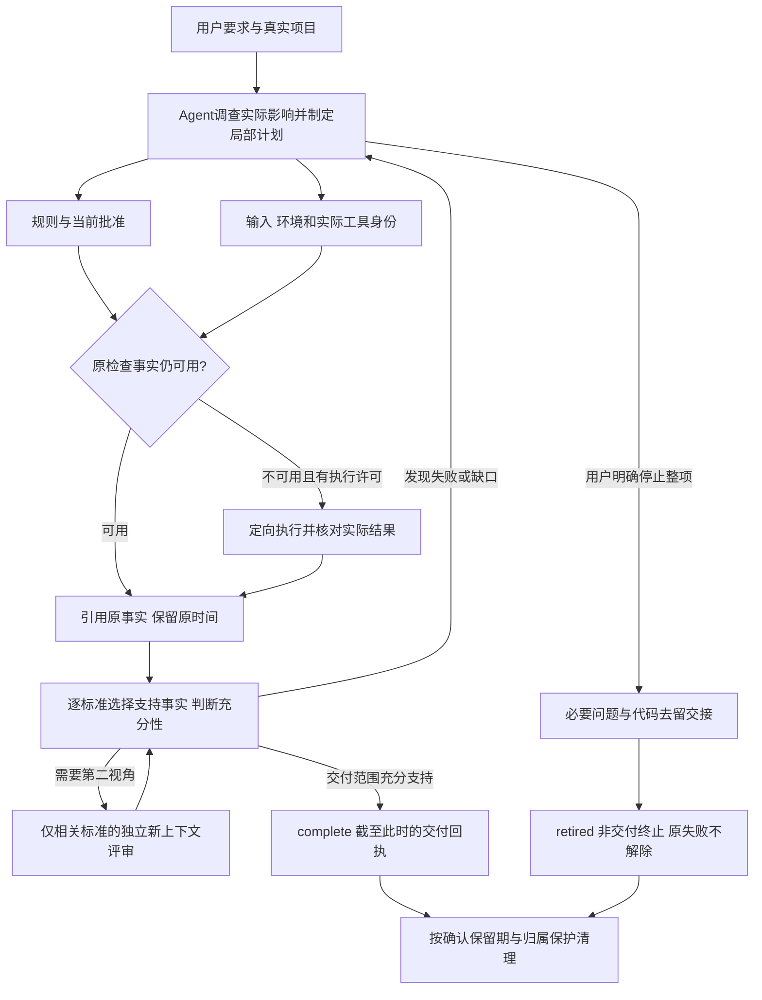
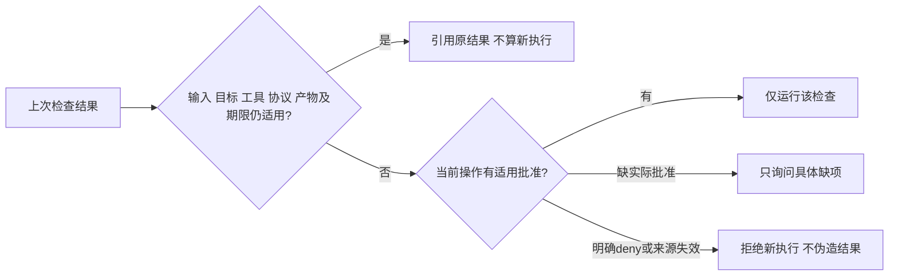
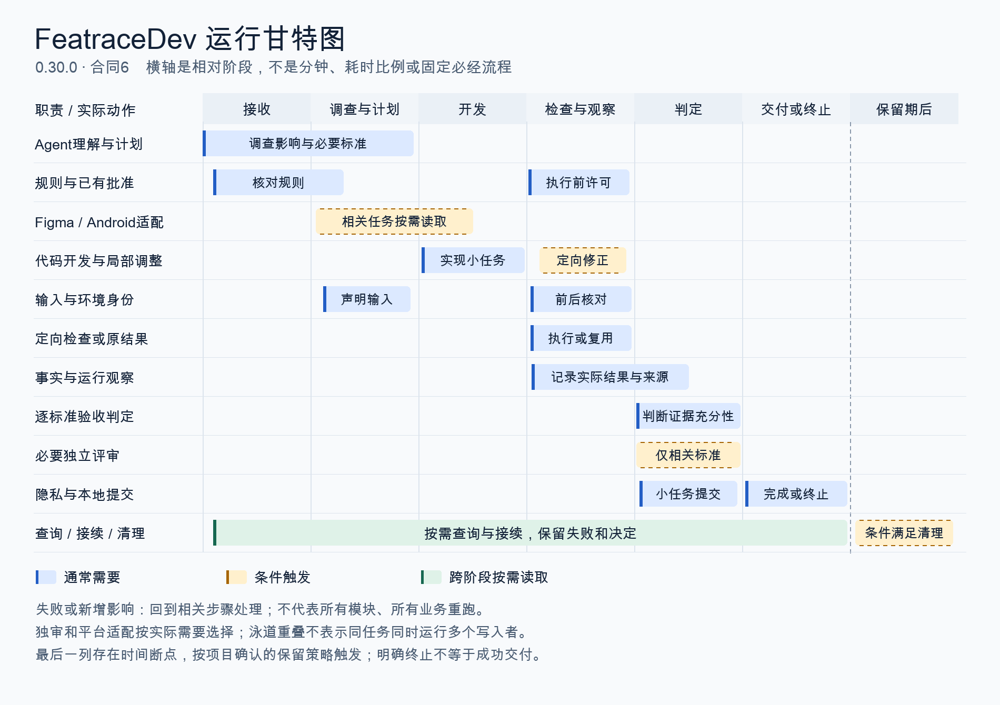

# FeatraceDev 模块与运行原理

核对：2026-10-27，0.30.0 / 任务合同6。发布、远端与实际安装以[维护核验](../MAINTAINER.md)为准。本页解释Skill本身，不是每个业务项目都要生成的模块档案。

可以把它理解成：**Agent负责理解、开发和判断；当前任务内核负责约束执行、保存实际事实、检查证据关系。** 它不是九个Agent，也不是自动理解代码含义的测试平台。

## 1. 九个功能分组，十五个运行文件

“九个”按职责归类，方便理解；一个文件可以承接多项职责。它不表示九个独立进程、九份上下文或九个强制阶段。安装包实际为十五个文件：SKILL入口、宿主元数据、四份参考指引、一个Android适配和八个脚本。安装器另在维护仓库，不是日常安装包中的第十六个运行文件。

| 功能分组 | 它解决什么问题 | 现有实现方式 | 它不自动证明什么 |
|---|---|---|---|
| ① 入口、影响调查与计划 | 知道本次要改什么、该测哪些地方 | [SKILL](../skills/dev/SKILL.md)与[工作指引](../skills/dev/core/references/task-workflow.md)引导Agent读真实需求、代码/调用方/资源；plan声明范围、标准、检查、局部未知和评审选择。内核校验结构及关系 | 分类不等于完整因果分析；不自动发现全部调用方，不按改动行数定测试等级 |
| ② 项目规则与执行批准 | 遵守真实项目约束，复用已有授权 | [task_policy](../skills/dev/core/scripts/task_policy.py)保存适用规则、来源/范围和保留策略；[task_authorization](../skills/dev/core/scripts/task_authorization.py)保存有限once/task批准，启动前占用，保留原事实中的批准出处 | 项目策略不能覆盖宿主限制、hooks或CI；“用了Skill”不代表任意操作都已授权 |
| ③ 输入、环境与工具身份 | 判断旧检查还能否使用 | [task_inputs](../skills/dev/core/scripts/task_inputs.py)计算声明文件/目录/外部输入的字节和成员身份；内核绑定命令、目标、实际执行器、相关约束与执行协议。inherit为缺省，controlled仅传选定存在的键和固定PATH | PATH不等于整条工具链身份；SDK和子工具仍需声明，不是自动依赖图或操作系统沙箱 |
| ④ 检查执行 | 真正运行缺失/变化的定向检查 | [task_execution](../skills/dev/core/scripts/task_execution.py)启动子进程、控制时间/输出、保留日志；内核先保存“结果未知”的尝试和批准占用，再启动，执行后核对输入漂移 | 命令成功不证明Gradle内部测试本次实际执行，也不等于业务验收通过 |
| ⑤ 事实、资料与验收判断 | 让结论引用真正支持它的证据 | [task_assets](../skills/dev/core/scripts/task_assets.py)保存选定输入/证据副本与出处、字节、归属；[task_workflow](../skills/dev/core/scripts/task_workflow.py)保存命令、静态分析、运行观察，按标准显式选取事实并assess。必要独审由真实新上下文提供结果 | 哈希不能证明语义正确；静态无影响证据不能冒充新UI实测，审查者也不能代替缺失的产品决定 |
| ⑥ 失败处置与任务生命周期 | 防止失败被后来的通过或措辞洗掉 | [task_failures](../skills/dev/core/scripts/task_failures.py)关联原失败及显式resolve/clarify/reopen；内核另管整条承诺延期、complete、correct和retire。旧失败始终保留，解除须针对性事实 | 对照组通过不自动修复首轮失败；延期不是支持；retired不是交付成功，也不回滚代码 |
| ⑦ 查询、接续与到期清理 | 控制读取量、恢复必要决策、清理临时数据 | 同一内核提供status/detail/review-input/list/code/storage和prune/cleanup/maintain。按需分页，有限差异诊断；记录校验、锁、预算、归属与交接保护；重复压缩不重复写任务 | 没有自动上下文压缩器、长期全局历史库、无限累计容量保证或个人定时守护进程 |
| ⑧ Figma与Android适配 | 用项目真实设计/平台选检查 | [Figma指引](../skills/dev/core/references/figma-design.md)限定节点/状态与视觉比较；[Android profile](../skills/dev/profiles/android/PROFILE.md)限定真实变体、工具链、实际测试执行与包/设备身份；按当前任务需要读取 | 它们是指引，不是内置Figma连接器、自动视觉裁判或全机型测试引擎 |
| ⑨ 隐私与发布安装 | 检查将要输出的内容，确保安装对应发布字节 | [output_privacy](../skills/dev/core/scripts/output_privacy.py)扫描明确文件或暂存新增行，候选须核实；维护仓库的[安装器](../scripts/install.py)核对固定引用/发布描述/字节，验证旧副本归属并备份更新 | no_matches不是全面隐私保证，截图仍需另外检查；固定本地引用不是远端签名认证 |

## 2. 运行关系



这些箭头表示依赖，不代表每次都要顺序执行所有分组。单纯文案/图标只验证其实际展示及受影响布局；若共享渲染则检查相关调用方，若连带搜索、点击、键盘或状态变化则加对应检查。独立评审按项目明确要求、后果、传播复杂度或实质盲点选择，不因“shared”一词就全项独审。

一次代码改动可能让一个检查失效，但不能据此推导全部业务都要重验。产品依据变化和真正执行输入变化分开；命令实际没变且原结果仍适用时，不为换结项阶段而重跑。

## 3. 旧结果复用和新执行批准是两个判断



例如批准过期只影响新运行，不能改写“原检查确实合法执行过”；但原输入或产物变了也不能靠旧批准继续复用。只读诊断解释有限类别，不修改这两个判断。

## 4. 上下文到底放在哪里

- **Agent主上下文**：需求理解、相关代码、实现和必要指引。只读当下相关部分；不是每次读取全部模块、历史PRD或全部日志。
- **任务JSON与产物**：主上下文之外的有界事实存储。它能提供原请求、计划、事实ID、失败、决定和下一步资料；本身不是另一个会推理的上下文。
- **脚本进程**：按输入读取必要文件、计算身份、执行/校验并返回结果。结束后没有一个持续保存全部对话的模块Agent。运行临时枚举可以较大，但不把全仓清单保存为永久记录。
- **必要独立评审上下文**：只有实际选中独审时才建立，提供相关标准、代码、选定事实和真实出处。它不是每个功能分组各常驻一位Agent。
- **Figma/Android材料**：相关任务按需加载，跨上下文先恢复当前任务与原证据，再读取缺少部分。没有自动控制模型上下文容量的机制，也不能保证不会撑满。

进度展示沿用宿主实际原生任务工具；没有工具时使用正常简短文字。Skill不会安装或伪造宿主UI。

## 5. 文件分工与增长边界

```text
业务项目/
├── 代码、测试、注释及项目已有简短问题说明   ← 长期知识，按实际必要性保留
├── .featrace-policy.json                 ← 当前项目规则、授权与清理策略
└── .featrace/                            ← 本地任务数据，默认不提交或自动分享
    ├── tasks/ID.json                    ← 当前请求、计划、事实引用、判断及回执
    ├── artifacts/ID/                    ← 有身份日志、选定输入与证据副本
    ├── scratch/ID/                      ← 授权范围内的临时调查材料
    └── locks/、maintenance.json          ← 有限锁和轮转游标
```

任务最多256KiB、128项事实；副本/日志有单文件和任务预算，查询分页，溢出拒绝而不截成“通过”。清理按项目确认的自然日保留期及manual/compact/forget策略执行，常见配置是7天，不代表所有文件到7天自动删除。明确终止的任务从实际retired_at计算，未决问题先交接，未知/变更文件及他人原件不删。compact保留精简回执，forget才移除符合条件的任务记录；它们不删除代码或Git历史。

单任务有界并不代表大量未完成任务的累计空间已有全局硬上限。现有办法是只读storage可见性、明确终止与必要交接、有界轮转清理；不为降体积自动遗忘失败。

## 6. 本轮更新究竟替换了什么

- 在原来单一继承环境路径上，加入**实际限制子进程变量**的受控分支；默认继承保留。不是只从摘要里忽略PATH。
- 在“只能完成或一直未完成”之外，加入**明确的非交付终止**；失败、交付和生命周期不再混成一个状态。
- 修正长文本分页默认值和重复compact写盘；增加只读失效诊断，分清旧结果适用性与新执行许可。
- 为执行事实保存当时最小命令/目标定义，避免改同名检查后错误描述旧失败。旧合同1–5固定原工具，不自动迁移、重签或重验。

当前程序验证343项、定点独立源码评审及有限合成Agent演练分别形成证据。它们不证明自然压缩恢复、长期语义判断、完整动态依赖或等质量净效率已经达标；第二阶段继续开放。


## 7. 运行甘特图



这是相对运行阶段的甘特式示意，横轴不代表分钟、固定耗时比例或每个任务必须经过的阶段。条带重叠不承诺同一任务并行写入；同一任务写操作受本地锁保护。图按一轮主链说明，失败/新影响回到相关步骤，不能据图要求全业务重测。独审/平台适配按需，旧结果可复用；检查通过的小任务依真实提交许可及时提交，不等整项结项。用户明确停止可在尚未完成时进入retire，不必走完开发/验收；图的终点列只表示两种不同结果。

最后一列与当前任务存在时间断点；按确认保留期和归属/交接条件清理，未到期或条件不足不删。既有老任务的到期维护可能在新任务开始时被有限轮转，本图不把它画成新任务必须等待的步骤。
