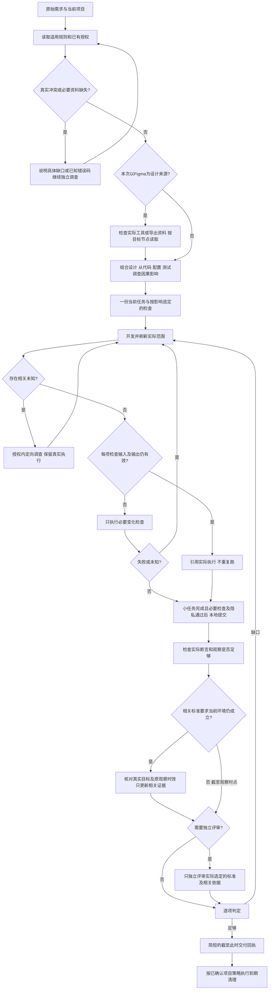

# 使用与接续

核对日期：2026-10-23。**本页描述0.24.0当前任务工作流**；实际发布与日常安装身份以MAINTAINER为准。0.22.0及其旧记录命令见固定的[旧版使用说明](https://github.com/P3rryW4ng/featrace-dev/blob/54c5260fd6688a0bca9c83f29bad240321a67b52/docs/usage.md)。不从 main 直接更新日常安装。

0.24.0已正式发布并安装CC。下方“源码候选”段描述本次已交付规则，其“未安装”文字是开发截点；当前身份以维护入口为准，旧观察/测试事实不重签。

## 普通开发

Claude 使用 `/dev`，Codex 使用 `$dev`，随后直接给原始需求、目标项目和必要参考图。空调用只开启本会话模式，不扫描或建档。实际可用时直接调用宿主原生任务/计划工具，展示、状态和加载效果均由宿主负责；不用正文另画勾选框、状态符号或阶段清单。没有原生工具时按需说明一次，沿用宿主日常简短进展文字，不规定“当前工作/阻塞/下一步”等模板。

业务影响范围和执行输入分开：两个 UI 文件可以是全部验收影响面，而构建仍需核对源代码、依赖模块、工具链和资源。后者变动只影响执行结果复用，不据此全面复核业务。仅 UI 的改动重点检验展示和实际受影响布局；共享渲染扩大到调用方，逻辑测试须有因果路径。未知不直接冒充局部，但也不自动触发所有旧 PRD 验收。

## 文件与生命周期

- 代码/配置/测试：实现事实；产品意图不能由实现自行证明。
- `.featrace-policy.json`：一份可共享的当前项目约束、真实授权依据和保留策略；不改变宿主权限或 hook。
- `.featrace/tasks/ID.json`：一份活动任务，最大256KiB；保存原请求、当前范围、检查、事实、结论和限制，无整仓快照或报告镜像。
- `.featrace/artifacts/ID/`：临时执行输出和通过attach登记的截图/证据副本；单日志/副本硬上限16MiB、合计预算64MiB。不是永久证据库。
- `.featrace/maintenance.json`及最多64任务锁及独立维护锁：本地游标与并发控制，无第二份需求台账。

项目设置添加窄范围忽略块，真实已跟踪数据/自定义冲突拒绝覆盖。默认建议结项7自然日后忘记已完成任务，策略由项目实际授权确认。每次开始/结项按策略轮转处理到期数据；显式 maintain 可供团队现有调度接入，不安装个人定时器。不完整任务不清；限制未交接、不明文件或链接一律保留，并给出定位原因。清理不改代码、用户原件、旧业务记录或 Git 历史。遗忘后不承诺恢复原始过程；重要约束和问题应进入测试/注释/现有项目说明或问题追踪。

## 查询与必要控制

普通用户不必记内部命令；Agent 使用[任务说明](../skills/dev/core/references/task-workflow.md)。`status/list/storage/locate/code/detail/review-input`只读，默认摘要与显式分页，不跑测试。长文分段读取，原生任务展示不存第二份进度。

真实失败不能通过静态分析或删选择变绿；静态分析可以支持“本次改动无影响”。独立评审由实际风险和项目规则决定，不要求每次全量深审。远端/设备结果必须不复用并限时有效；输入声明完整性与独立出处仍需真实调查。新包不提供全语义依赖图、通用设备驱动或 Windows runner。

明确请求接续旧 `.agent-workflow` 时使用原版本的独立固定安装，或明确约定诚实的新任务范围；新包不读写、迁移、压缩或删除旧记录。新 ID 不能隐藏相关未解决失败。发布安装与业务接续分开，不自动重开旧需求或迁移其记录。

## 审核后边界

任务只核对自己声明的改动和实际相关输入；无关分支改动显示数量提示，不再整体作废。相关任务输入变动仍要刷新计划。局部未知关联标准/检查，其余检查可继续；调查入口不会放宽权限/输入保护，未知解决前不能结项。同一有效调查结果可用于后续实际判定，不为登记再跑一次。运行失败独立保留，不可用/静态登记不能解除。

storage按页给出任务状态、记录大小、陈旧未完成项，整体本地扫描超上限明确不完整；不修改数据，不把累计风险自动变成删除。状态计数明确仅当前页，时间是上次记录写入时间，不是人工工时。

新版安装器默认要求release.json内版本、运行哈希及安装器哈希匹配已提交内容，且HEAD对应本地固定release/<版本>分支或v<版本>标签。发布前在冻结源码上生成该描述、一起提交并固定引用；0.23.0随发布提交生成描述；实际推送/安装结果单独核对。候选隔离试装须显式--development，标为开发版并记录来源提交/内容身份；不是正式VERSION身份，也不是签名远端认证。旧0.22.0安装器不自动获得这些保护。

## Figma 设计实现

仅实际使用Figma设计时，按需读取[适配指引](../skills/dev/core/references/figma-design.md)。先确认当前宿主可用工具和目标节点访问；声明了工具不等于CC已连接或文件已授权。按节点读取设计/截图与必要父布局、共享组件和状态；不可用时按已有截图/导出资料继续可确认的部分，明确缺失项，不伪造设计参数。使用现有项目组件/资源，将目标展示变成当前任务的局部验收，不建立另一份设计台账。

主Agent按需共享设计与代码上下文，不为Figma固定新开Agent；大页面按区域展开，压缩后从当前任务和选定设计证据恢复。内核不自动监控远端设计更新；记录实际节点/版本或读取时点，验收前核对相关参考是否仍适用，不能把“符合当时截图”说成“已认证最新设计”。实际渲染对比与构建/静态核查分开，缺少真实设计/项目时不能声称还原成功。不写回Figma，不安装连接器，不增加全文件同步/永久镜像/通用像素评分。

## 2026-10-23 源码候选：局部评审与约束

以下已实现于未发布源码，日常CC仍为正式0.23.1，不提前宣称安装生效。review.criteria列出必须独立评审的标准，混合任务不因一个共享标准强制其余标准独立评审。局部约束用decision/criteria/checks选择实际适用对象；原字符串仍全局适用，不自动缩小旧授权或规则。相关执行约束变化仍需重新调查并使对应检查失效，产品依据变化不自动要求无关检查重跑。

失败详情可以分页恢复原未解决失败；捕获到的执行中断及结束身份核对异常登记为不可用，不沿用旧通过状态。不是断电/SIGKILL下的事务恢复保证。权限、原失败、产品依据和真实新上下文要求均保留。观察时效契约、跨检查扫描成本和实际宿主展示另列待评估，不属于本批实现。

## 源码候选：观察适用时点

局部UI截图可声明validity.mode=as_of，时间过去本身不要求重拍；当前后端配置等主张声明current、真实target、有依据的max_age_seconds和reason。时效从原observed_at/执行started_at计算，登记或复核不会刷新时钟。过期只让相关标准需要更新证据，原失败不自动解除，无关检查不重跑。已知环境变化应更新实际对象并调查，工具不能自动发现远端变化。

旧活跃记录未声明则显示undeclared，不自动当作历史或当前认证，不迁移已结项记录。此实现属于尚未发布候选，正式CC仍0.23.1；完整字段见运行指引。没有定时唤醒、统一截图过期时间或扫描缓存。

## 源码候选：按完成的小任务本地提交

开发拆分成可独立审阅、可工作的子任务；每项实现和必要定向检查完成、选定新增内容隐私核对后，就本地提交并汇报提交号，不等整项结项。代码和相关测试放一起，不按每次编辑制造碎片提交。最终功能的未知/失败和验收仍继续，子任务提交不表示整项通过。

复用同范围提交授权；明确禁止/手动提交要求或未裁决的实际冲突优先处理。只暂存自己的路径/变更块，不夹带其他人改动，不自动push或重写历史。提交本身未改变检查输入时，不为新HEAD重复测试或改写原包身份。当前只是未发布指引，CC仍正式0.23.1；安装新版后才宣称该指引已进入日常运行包。

## OGFR-8897反馈后的维护候选

源码候选对已知policy错误返回具体错误码，例如PROJECT_POLICY_REQUIRED和OPERATION_POLICY_ASK/DENIED；未预期解析/系统异常仍只报安全通用错误，不输出私有内容。尚未发布安装，正式CC仍0.24.0。

Android检查区分命令执行、测试实际执行和Gradle复用。UP-TO-DATE/FROM-CACHE不自动失败，也不等于新跑了测试；应引用原结果产生者、原时间和适用性。不能为登记统一增加--rerun-tasks。原输入身份缺失时先核查相关差异/产物来源，无法建立适用性才考虑定向执行。程序退出成功与业务断言充分性分开。
