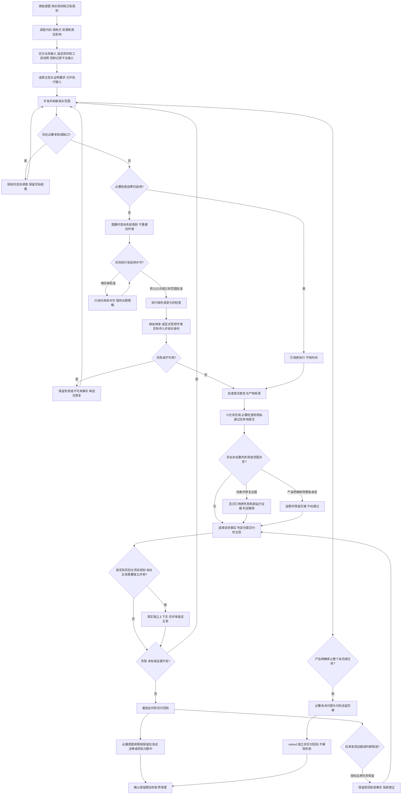

# 使用与接续

核对日期：2026-10-27。0.30.0发布准备，合同6；正式推送和日常CC更新核验见MAINTAINER，原CC0.29.0，15个运行文件。旧合同5固定0.29.0，旧4固定0.28.0，更早使用其原工具；不迁移业务。实际身份见[MAINTAINER](../MAINTAINER.md)。

## 日常运行

Claude入口`/dev`，Codex入口`$dev`。原始需求、相关产品资料、代码和实际项目规则决定影响面；类别组合用于调查，不是固定测试等级或最大套件。原生任务/计划工具可用就沿用宿主展示，无工具则普通简短进度，不手绘勾选框或固定阶段。

## 共享影响与评审必要性分开

先调查实际调用及公共契约，按因果范围选择展示、交互或接口验证；shared不再单独强制独立评审。按项目明确要求、严重后果、复杂传播或实质盲点决定是否需要第二视角，仅审选定主张。局部低风险共享展示可在证据充分且无强制规则时自评；单调用高风险也可能必须独审。项目规则不会被Skill覆盖，语义调查和规则取舍不由字段校验自动证明。

新计划显式选择review.criteria，旧省略范围的全局含义保留。执行入口校验输入/环境/权限/未知；验收入口另核证明与评审策略。新协议不再因评审校验源码变化而作废执行，但真正执行校验变化仍失效；本次首次拆分会改变旧协议，旧活动任务固定原工具，不迁移、不重签。原0.26.1活动任务继续使用其固定工具，安装新版不自动认证已有交付。

## 主张、事实与执行的区别

是否改动不直接决定证明方式。充分的静态链条可证明结构或无影响；新展示、设备和真实外部响应需要对应观察。复合承诺可引用多项事实，必要时才拆成独立主张。单条通过命令不自动覆盖全部承诺，也不证明Gradle内部测试本次实际运行。

一个任务内事实按ID保留，当前检查/观察入口是引用；评估显式选择实际支持的子集。新观察不覆盖旧依据，未选择的额外通过结果不使既有判断过期。真实失败仍独立阻塞，不能靠静态、改标签、删引用或自由文字限制消除。

执行身份区分实际输入、执行协议和生产者出处。查询展示代码改变不重跑业务；执行模块、输入/权限收集及实际执行辅助逻辑变化仍影响协议。没有逐版本兼容白名单；旧协议/来源不能凭填写版本号获得复用。不存在通用动态依赖证明或跨机器缓存。

## 文件与恢复

- 代码/配置/测试是实现事实，不能自行定义产品意图。
- `.featrace-policy.json`是一份真实项目规则/授权/保留策略，不覆盖宿主规则。
- `.featrace/tasks/ID.json`是有界当前任务：合同6、128事实/256KiB，支持引用、更正与失败保护；无全仓快照或永久历史库。
- `.featrace/artifacts/ID/`保存临时有身份日志及登记证据副本，16MiB/文件、64MiB/任务；原件不删。
- 本地游标与锁只服务轮转和并发，不是另一份需求台账。

具体字段和命令见[运行指引](../skills/dev/core/references/task-workflow.md)。先看status，再按主张读选定事实与缺口；`detail --section fact`可恢复原来源。预览不是全文，长内容按游标读取，不默认加载全部更正历史。

超过当前事实需求时，prune先预览再显式应用，仅回收未引用通过事实元数据，不能删除负面、当前引用或更正来源。任务仍有上限，超限拒绝而非截断。完成后按项目确认的自然日策略轮转清理，未知文件、不完整任务、未交接限制保留；无个人后台定时任务。重要长期约束回到测试、注释或项目既有精简文档。

## 专项与发布边界

仅Android任务读取对应profile，按真实断言、目标变体、工具链与设备影响选择检查；不默认整套重跑。UP-TO-DATE/FROM-CACHE可引用仍适用的原结果，不伪称新跑；来源不足才定向补证。实际APK哈希、设备和环境另核对，不用登记HEAD冒充包身份。

仅Figma作为来源时读取[适配说明](../skills/dev/core/references/figma-design.md)，使用实际宿主工具/目标节点及相关状态。缺资料保持未知，不伪造设计参数，不增加永久设计镜像或同步后台。

已完成的小任务及时本地提交精确自有变更，未改检查输入就不因HEAD变化重跑。不隐含push、安装或整项结项；实际项目禁止/手动提交规则继续适用。隐私检查只扫描待分享内容，有限无匹配不等于全面安全。

正式0.26.1的VERSION、发布描述与固定引用须一致，安装器保留所有权/备份检查；不从漂移main正式安装。0.25.0旧命令与记录见[固定发布源码](https://github.com/P3rryW4ng/featrace-dev/tree/v0.25.0)。

### 状态阻塞定位（0.26.1补丁）

活动任务status保留原SCOPE_NOT_READY阻塞标记，增加scope_readiness：范围未知、输入需重新分析、缺项目规则、适用规则变动等已知安全原因各自显示，并指向plan/request详情。未知异常保持通用提示，不回显路径或原文。scope_readiness.ready只说明范围就绪，检查、主张和失败仍分别决定是否可交付；查询不执行测试、不修改记录。实际CC安装身份见MAINTAINER。

### 新说明、接续与长期知识（0.26.1指引完善）

新说明先判断新增/澄清/变更/误读更正，复用plan中受影响标准、检查、来源与reason更新当前决定；原request和事实时间不重签。不以新ID绕过失败；真实撤回与现有失败保护冲突时如实报告边界，不伪造已解决。

换上下文先查当前任务与实际规则，再恢复目标、重要决定及依据、选定事实/未解决问题和下一动作。确有必要时在现有plan.reason保留一份简短当前提要，不建立接续台账或每步写入；没有提要就据实际材料恢复，缺什么才问什么。

实施时同步考虑非显然修复原因、行为边界和限制的长期去向，优先现有测试/邻近注释/精简问题位置，足够则不重复。没有新增长期知识就明确无需新增；缺自动回归资产不自动推翻当次充分证据。内核并不自动核查所有重要意图的交接，原清理/限制保护不变。

下一自然需求按[精简试点标准](pilot-observation.md)只读复盘一次，复用现成产物，不追加评分测试。上述为已有入口上的指引改进，不是新合同/新字段或已验证的自主恢复能力。

## main候选：观察、解除与延期分离

观察不会自动清除失败；条件不同的对照通过只作旁证。显式failure处置引用原失败ID和同条件的新运行事实，多失败逐项保留。条件未知可先记事实，之后据原证据澄清，不重签观察。误解除可reopen保留历史；已complete先走有授权的局部correct。普通无失败任务没有新增处置步骤。

产品决定排除整条承诺时，显式defer并保存原决定时间/依据和任务外交接；未满足承诺显示deferred而非supported，不复验其专属检查，混合覆盖的必需检查保留。“以后再修但本次仍承诺”继续阻塞。回执分别报告支持与延期范围，新失败/来源变化/交接丢失不自动沿用排除。清理前核对交接还在。

旧合同3活动任务固定0.27.0（更早工具的真实执行仍使用其原工具），不自动升级、纠正或重测OGFR-9060-9062。0.28.0增加聚焦失败关系的模块，共13运行文件；正式日常安装已核验，见MAINTAINER。

0.29.0合同5授权：一次批准不再改长期策略；真实范围批准以authorize保存有界出处，一次尝试和明确的任务重试范围分开。旧结果复用不是新执行，到期不抹去原合法事实，实际deny和来源变化不绕过。资料角色已实现为input_assets/source_assets，完整286项联合验证已通过，发布和安装的实际身份见MAINTAINER。

0.29.0合同5资料：attach --role input登记选定快照；检查引用input_assets、标准引用source_assets。外部实时输入沿用external_inputs。实际脚本/字节/出处一致；快照不代表远端当前。prune显式回收未引用输入副本，保留负面/当前/更正引用，原件不删。显示名参与搜索等交互时调查相关影响，不扩大为全业务复核。

2026-10-27源码查询小修：detail未指定limit时采用现有长文本分页容量（最多2000字符/页），list/status等仍默认20项；显式limit与16KiB输出限制不变。正式CC仍0.29.0，是否发布另行核对；此修改不重跑业务或变更任务合同。

2026-10-27维护候选：已压缩且无剩余自有输出的任务再次cleanup为changed=false，不写回任务；maintain只统计实际变化，轮转继续。保留期、交接、未知文件和中断后剩余输出检查仍先执行，显式forget仍可用。未发布安装。

2026-10-27环境诊断候选：detail --section check --check K分页解释旧结果与当前新执行许可；新事实仅存组件摘要，旧事实缺数据明确not_collected。实际输入/协议/产物/时效/权限仍由原runner判定，不收窄PATH、不补造历史。输入/协议采集代码变化意味着首次新协议不同，活动旧任务固定原工具；未发布安装。

## 合同6：受控环境

0.30.0新增显式execution_env，发布/安装的实际身份见MAINTAINER。省略时保留继承；controlled只传选定宿主键和固定绝对搜索路径，并按该路径解析、绑定和启动顶层执行器。真正SDK/子工具字节仍须声明输入；不是系统沙箱或动态依赖发现器。新任务写合同6，旧1–5固定原工具拒读不改写。配置形状见运行指引；不得为通过旧任务自动转换。

## 合同6：非交付终止

明确停止未完成任务时使用retire，产生独立非交付回执。代码不回滚、失败不解除，未结束更正和原回执不改成成功；有代码风险/失败/未知时先验证现有精简问题位置的交接。终止后常规写入口拒绝，status/list/storage单列。保留期自实际终止起算，沿用原清理策略/归属保护；不是自动删陈旧草稿。完成交付继续使用correct/cleanup，恢复工作须新请求调查当前代码及存活问题。实际发布/安装以MAINTAINER核验为准。
